# System Workflow

This diagram follows the Flask application launched by `python app.py` (also used by the `npm start` script). The Express files under `server.js` and `src/` are a legacy implementation and are not part of this runtime path.

```mermaid
flowchart TB
    Player[Player]
    Browser[Browser UI<br/>public HTML, CSS, JavaScript]
    API[Flask application<br/>app.py · REST API · session auth]
    Game[Game logic<br/>magic-square generation<br/>validation · daily sequence · achievements]
    DB[(PostgreSQL via DATABASE_URL<br/>SQLite for local development)]
    Guide[Reviewed guide<br/>knowledge/magic-square-guide.md]
    Rules[Curated chatbot rules<br/>chatbot_rules.py · chatbot_i18n.py]
    OpenAI[OpenAI Responses API<br/>optional · requires OPENAI_API_KEY]
    Mail[Email delivery<br/>optional account verification/reset]

    Player -->|visits and plays| Browser
    Browser -->|static pages and assets| API
    Browser <-->|JSON requests and responses| API
    API -->|authenticated game and account operations| Game
    Game <-->|users, sessions, attempts,<br/>achievements and chat history| DB
    API -->|leaderboards and admin views| DB
    API -->|select relevant excerpts| Guide
    API -->|fallback answer and language support| Rules
    API -->|question + language + guide excerpts<br/>when configured| OpenAI
    API -->|verification and reset messages<br/>when configured| Mail

    subgraph Game lifecycle
      Start[Start puzzle or daily challenge]
      Solve[Play in browser<br/>record moves and hints]
      Check{Server validates<br/>completed board}
      Save[Save attempt and update<br/>streaks / achievements]
      View[Show result, progress<br/>and leaderboard]
      Start --> Solve --> Check
      Check -->|valid| Save --> View
      Check -->|invalid| Solve
    end
    Browser --> Start
    Start --> API
    Check --> API
    API --> Save
    View --> Browser
```

## Runtime notes

- Flask serves the frontend files from `public/` and handles `/api/*` requests.
- Session cookies identify signed-in players. Protected endpoints enforce authentication; admin endpoints also require an administrator role.
- Local development defaults to `data/data.sqlite`. Render deployment uses PostgreSQL through `DATABASE_URL` so accounts and game history survive web service restarts and code updates. The Render Free Postgres database itself expires 30 days after creation, so export and migrate its data before expiration if you want to keep it.
- Chatbot answers use curated local responses when OpenAI is unavailable. When enabled, the application sends the current question, reply language, and selected guide excerpts to OpenAI.
